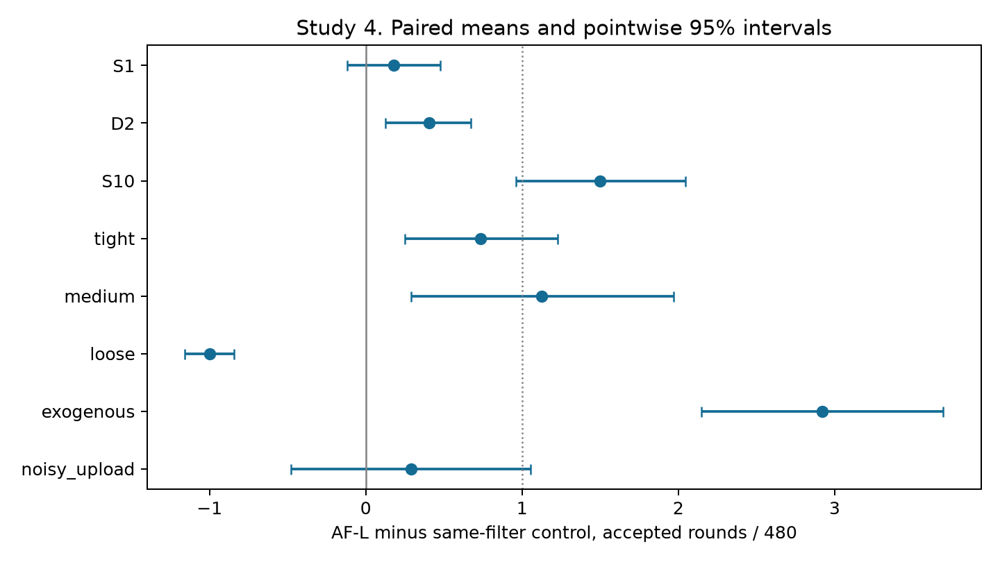
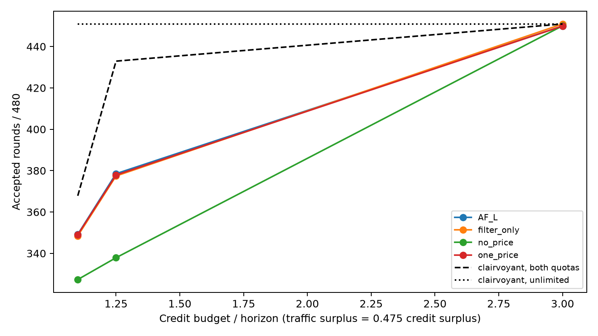

# Результаты выполнения исследовательского плана

**21 ноября 2026 года.** Код v4 перенесён в основной проект. Исследование началось 20 ноября с локально зафиксированным планом, хешами и исполняемым снимком исходников. Серия завершена полностью — восемь условий, 128 новых сидов на условие, семь политик, 7 168 эпизодов и 3 440 640 модельных раундов. Единица статистического анализа — парная разность по сиду.

Новый результат объясняет вклад компонентов. Адаптивные цены существенно помогают расходовать дефицитный ресурс. Дополнительная остаточная регрессия поверх общего фильтра даёт умеренную прибавку. Условие универсального превосходства не выполняется. На свободном бюджете более простой фильтр работает лучше.

## Первичное сравнение

На трёх заранее выбранных опорных профилях S1, D2 и S10 средняя парная прибавка AF-L над контролем с тем же фильтром и ценами составила **+0.70 раунда за 480**, 95% интервал **[0.47; 0.92]**, двухсторонний Wilcoxon p = 5.39e-08. Сводный показатель сначала усредняет три разности внутри каждого сида. Получены 86 положительных, 10 нулевых и 32 отрицательных сводных разности. Заранее заданный критерий практического превосходства требовал нижнюю границу выше +1. Он не выполнен. Wilcoxon проверяет положение распределения парных разностей. Интервал среднего получен отдельным бутстрепом блоков по сиду.

Контроль filter_only получает те же вероятности LatentFaultFilter, задержанные счётчики надёжности S/U, маски этапов, квоты и пересчитываемые цены. Его остаточные коэффициенты равны нулю, alpha=0. В residual_greedy включена остаточная регрессия, alpha=0. В полном AF-L alpha=0,05. Все параметры закреплены до новых запусков.

## Восемь условий

В таблице pointwise 95% интервалы среднего. Для восьми тестов AF-L против filter_only применена поправка Holm. Другие сравнения компонентов исследовательские.

| Условие | AF-L | Общий фильтр | Разность и 95% интервал | Holm p |
|---|---:|---:|---|---:|
| S1 | 454.96 | 454.78 | +0.18 [-0.12; +0.48] | 0.249 |
| D2 | 456.13 | 455.73 | +0.41 [+0.12; +0.67] | 0.0195 |
| S10 | 409.34 | 407.84 | +1.50 [+0.96; +2.05] | 6.75e-06 |
| tight | 349.20 | 348.46 | +0.73 [+0.25; +1.23] | 0.0195 |
| medium | 378.53 | 377.41 | +1.12 [+0.29; +1.97] | 0.0302 |
| loose | 449.91 | 450.91 | -1.00 [-1.16; -0.84] | 3.95e-16 |
| exogenous | 361.44 | 358.52 | +2.92 [+2.15; +3.70] | 1.53e-09 |
| noisy_upload | 359.84 | 359.55 | +0.29 [-0.48; +1.05] | 0.249 |

Положительный эффект поддержан в D2, S10, tight, medium и exogenous. В loose поддержан отрицательный эффект. В S1 и noisy_upload убедительного отличия нет. Наибольшая прибавка +2,92 возникает после сдвига последовательности отказов относительно когорт. Этот контроль сохраняет частоты и серии отказов, но разрушает исходную привязку к текущему составу. Результат показывает роль калибровки прогнозов при ошибочной модели атрибуции. Он сам по себе не доказывает пользу идентификации виновного участника.

Добавление UCB к той же остаточной регрессии даёт по опорным профилям +0,21, +0,04 и +0,03 раунда. В medium прибавка +0,48 [0,04; 0,93]. В loose эффект −0,11 [−0,20; −0,02]. Эти сравнения требуют отдельного подтверждения, если их использовать как самостоятельное заявление. Включение UCB не объясняет основную прибавку прежнего AF-L над старым контролем.

## Проверка ресурсного дефицита

В tight, medium и loose совпадают физические миры. Меняются только лимиты. Для tight заданы 528 кредитов и 502,8 единицы нормированного трафика за 480 раундов, для medium — 600 и 537, для loose — 1 440 и 936. Последнее условие допускает самое дорогое действие в каждом раунде.

| Условие | Миров, где бюджет снижает оптимум | Миров, где влияет кредитная квота | Миров, где влияет трафиковая квота |
|---|---:|---:|---:|
| tight | 128/128 | 127/128 | 0/128 |
| medium | 98/128 | 48/128 | 41/128 |
| loose | 0/128 | 0/128 | 0/128 |

Влияние квоты определяется точным оптимумом после снятия только этой квоты. В tight ресурс ограничивает результат во всех мирах, однако трафиковый лимит не меняет всеведущий оптимум. В medium оба лимита влияют на оптимум в части миров. Их возможное одновременное влияние следует измерять отдельно.

В парном исследовательском сравнении residual_greedy с тем же обучением, но отключёнными ценами, получены +21,70 [20,64; 22,77] раунда в tight и +40,15 [38,27; 42,02] в medium. Жёсткие квоты и резерв на обязательные будущие раунды сохранены в обеих политиках. Это оценка пользы адаптивного распределения по отношению к конкретной политике без цен.

При одинаковых прогнозах и UCB пересчитываемые цены AF-L превосходят градиентные цены с eta=0,05 на +1,80 [1,20; 2,38] в tight и +3,92 [2,98; 4,91] в medium. Для сравнения с оптимально настроенным градиентным алгоритмом нужен выбор eta на отдельных данных разработки. Включение второй цены при сохранённых двух жёстких квотах добавило +0,66 [0,02; 1,30] в medium.

На графике показаны три измеренные пары лимитов. Соединяющие отрезки служат ориентиром. Бюджетная кривая подтверждает существенную роль дефицита. Остаток до всеведущего оптимума в medium всё ещё велик — 54,41 раунда у AF-L. Выяснить, какая часть этого разрыва устранима без знания будущего, остаётся исследовательской задачей.

## Исправления и внешняя проверка

Исправленный байесовский ориентир получает только фактически доступные метки. E и M поступают после выполненного этапа, S и U — с задержкой два раунда, как в фильтре AF-L. Для поздних меток пересчитывается фильтрация скрытых состояний. Исправлены все 864 эпизода, где этот ориентир использовался в Study 3. Максимальное изменение среднего результата составило −0,66 обновления. Ориентир по-прежнему знает параметры и группы генератора, а его ценовое распределение остаётся эвристикой. Первичные числа AF-L и контролей v3 сохранены.

TCP-исполнитель поддерживает восстановление из смешанных основных и резервных копий фрагментов. Новая версия обратной связи 3 определяет отказ восстановления по факту отсутствия полного агрегата после отказа основной ветви. Исторические журналы версии 2 сохраняют прежнюю интерпретацию. Все 16 комбинаций отказов четырёх реплик проверены настоящими локальными TCP-раундами. Для воспроизводимого парного режима созданы детерминированные дополнительные аккаунты исключительно тестовой EVM. Два режима с 16 клиентами получили тождественные когорты и прошли штатный аудит.

Полный набор из 187 тестов прошёл. В первом запуске один тест не нашёл исполнимый тестовый SSH-скрипт после извлечения ZIP через Python. Право исполнения восстановлено, затем повторены распределённые тесты и полный набор. Скрипты облачной серии проверяют хеши плана и исходников, размещение ролей, соответствие фактической конфигурации запланированной, наличие каждого эпизода и непрерывную нумерацию раундов. Отдельные проверки убедились, что пропущенный эпизод и подмена конфигурации отвергаются.

Внешняя проверка использовала открытые измерения доступности PlanetLab All Pairs Ping из Repository of Availability Traces. Взяты семь непересекающихся групп по 18 наблюдаемых узлов и четыре временных окна на группу, шаг 15 минут, 480 шагов в окне. Два узла задают доступность альтернативных механизмов, остальные 16 — риски маршрута или ответа клиента. Такое соответствие наблюдаемой доступности механизмам исполнения задано моделью. В 84 эпизодах AF-L дал 394,71 принятого раунда, общий фильтр 394,93, контроль с поимёнными ответами 396,29. Это разведочная проверка на семи группах узлов. Для переноса на современные периферийные устройства потребуются независимые измерения маршрутов и нагрузки. Набор данных и описание формата сохранены вместе с хешем, параметрами отбора и исполняемым скриптом. [Источник трассы](https://pbg.web.engr.illinois.edu/availability/)

Семь групп внешних узлов не пересекаются, но их наблюдения могут коррелировать из-за общего времени и инфраструктуры. На этой проверке не заявляется универсальный статистический перенос. Низкая доступность на исторической трассе моделирует риск выбранного маршрута или ответа на проверку. Соответствие этим механизмам и доступность альтернатив заданы гибридной моделью.

## Структурное ограничение генератора

Во всех текущих синтетических условиях U может возникнуть только вместе с M. При этом резерв не портит исправную основную ветвь. Поэтому R+B имеет не меньший фактический успех, чем любое другое действие в каждом модельном раунде. Постоянное R+B точно достигает безлимитного оптимума во всех 1 024 мирах. В условиях свободного ресурса распределение затрат теряет смысл, а ошибки калибровки и разведки способны только ухудшать результат.

Это предположение генератора. TCP-протокол допускает потерю подписанного полного обновления при доступном ответе на проекцию, что уже покрыто тестами. Следующая содержательная проверка должна разорвать зависимость U от M, включить независимые и общие сбои двух каналов и учесть время ожидания резерва. Базовые частоты, параметры и интерфейс контроля следует закрепить на новых данных разработки до следующей серии. Старые результаты и гипотезы при этом сохраняются в их исходных условиях.

## Вывод для статьи и следующий этап

Формулировку о постоянном преимуществе над контролем с одинаковыми признаками следует заменить описанием измеренной границы применимости. Содержательный тезис ВКР — проверяемый состав OCP-FL позволяет связать накопленные сведения с текущим раундом, а адаптация PD-LinUCB распределяет ресурсы между исполнением и проверкой. Вклад остаточной калибровки зависит от бюджета и точности исходного фильтра. Самостоятельное превосходство UCB в данном стенде не установлено.

Ближайший внешний этап — пилот на разных ВМ с измерением прикладных байтов, длительности полного цикла и принятых обновлений за минуту. Затем нужны отдельные непересекающиеся измерения клиентских и общих сетевых отказов, адресный контроль и подтверждающий план по сетевой дисперсии. Для усиления алгоритма стоит сначала проверить, помогает ли выбирать между исходным фильтром и остаточной моделью наблюдаемая ошибка прогноза на прошлых выполненных этапах. Такое переключение требует нового протокола разработки и новых сидов.

Облачный комплект подготовлен для пилота из 24 эпизодов. В этой среде отсутствуют yc, Terraform и настроенный доступ к Yandex Cloud. Перед созданием платных ресурсов требуются cloud_id, folder_id, SSH-доступ и согласованный предел расходов. Общая жёсткая межхостовая квота физических байтов пока отсутствует.

## Воспроизводимость

Исходный снимок и план находятся в study4/frozen_sources.zip и study4/plan.json. Все 1 024 парных мира сохранены отдельными заданиями, результаты семи политик доступны в runs.csv, интервалы и контрасты — в results.json. Сид-блоки повторно выбираются 10 000 раз с фиксированным RNG. Исторические исходники и результаты v3 сохранены в отдельном каталоге. Рабочий код и основной проект сверены по install_manifest.json. До установки сохранён project_before_install.zip.

Для повторения запуска в дереве передачи перейти в work/af_v4_20261120, создать Python 3.13 окружение из requirements-lock.txt и выполнить python research/study4/study.py run ../../outputs/af_v4_20261120/study4. Завершённые задания пропускаются после проверки исходников. Для полного повторения использовать новый каталог, скопировать в него неизменённый plan.json и выполнить ту же команду с новым путём. Анализ запускается из корня передачи командой python outputs/af_v4_20261120/summarize.py. Для локальной проверки открытия портов требуется обычная возможность bind к localhost.
